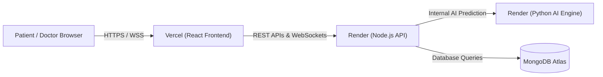

# DentaAI Deployment Guide (Vercel + Render + MongoDB Atlas)

This guide walks you through deploying the complete **DentaAI** full-stack system:
* **Frontend (React / Vite)**: Hosted on **Vercel**
* **Backend (Node.js / Express / Socket.IO)**: Hosted on **Render**
* **AI Inference Service (Python / Flask / TensorFlow)**: Hosted on **Render**
* **Database (MongoDB)**: Hosted on **MongoDB Atlas**

---

## Architecture Overview



---

## Step 1: Push Project to GitHub

Make sure all changes in this repository are committed and pushed to your GitHub repository:
```bash
git add .
git commit -m "Configure Vercel and Render deployment settings"
git push origin main
```

---

## Step 2: Set Up Free Cloud Database (MongoDB Atlas)

1. Sign up at [mongodb.com/cloud/atlas](https://www.mongodb.com/cloud/atlas).
2. Create a **Free Shared Cluster (M0)**.
3. In **Network Access**: Add IP Address `0.0.0.0/0` (Allow Access from Anywhere).
4. In **Database Access**: Create a database user with username and password.
5. In **Clusters > Connect > Drivers**, copy the connection string:
   ```
   mongodb+srv://<username>:<password>@cluster0.xxxxx.mongodb.net/dental_ai?retryWrites=true&w=majority
   ```

---

## Step 3: Deploy Backend & AI Service to Render

You can deploy using either **Option A (Render Blueprint - Easiest)** or **Option B (Manual Web Services)**.

### Option A: Using the Render Blueprint (`render.yaml`)
1. Log in to your [Render Dashboard](https://dashboard.render.com).
2. Click **New +** and select **Blueprint**.
3. Connect your GitHub repository `dental-ai-system`.
4. Render will read `render.yaml` and create both services:
   - `dentaai-backend` (Node.js)
   - `dentaai-ai-service` (Python)
5. Fill in the prompted environment variable:
   - `MONGODB_URI`: Paste your MongoDB Atlas connection string from Step 2.
6. Click **Apply**. Both services will build and deploy automatically!
7. Note down your backend URL (e.g. `https://dentaai-backend.onrender.com`).

---

### Option B: Manual Setup on Render

#### Service 1: Python AI Inference Engine
1. In Render, click **New + > Web Service**.
2. Select your repository.
3. Configure:
   * **Name**: `dentaai-ai-service`
   * **Root Directory**: `ai_model`
   * **Runtime**: `Python 3`
   * **Build Command**: `pip install -r requirements.txt`
   * **Start Command**: `gunicorn -w 1 --bind 0.0.0.0:$PORT app:app`
4. Click **Deploy Web Service** and copy its URL (e.g. `https://dentaai-ai-service.onrender.com`).

#### Service 2: Node.js Express Backend
1. In Render, click **New + > Web Service**.
2. Select your repository.
3. Configure:
   * **Name**: `dentaai-backend`
   * **Root Directory**: `backend`
   * **Runtime**: `Node`
   * **Build Command**: `npm install`
   * **Start Command**: `node server.js`
4. Add **Environment Variables**:
   * `NODE_ENV`: `production`
   * `PORT`: `10000`
   * `MONGODB_URI`: `<Your MongoDB Atlas connection string>`
   * `JWT_SECRET`: `<A random 32+ character string>`
   * `AI_SERVICE_URL`: `<URL of the AI service from Service 1>` (e.g. `https://dentaai-ai-service.onrender.com`)
   * `CORS_ORIGINS`: `*` (or your future Vercel frontend URL)
5. Click **Deploy Web Service** and copy its URL (e.g. `https://dentaai-backend.onrender.com`).

---

## Step 4: Deploy Frontend to Vercel

1. Log in to [Vercel](https://vercel.com) and click **Add New... > Project**.
2. Select your `dental-ai-system` repository.
3. In the project setup screen:
   * **Root Directory**: Click "Edit" and choose `frontend`.
   * **Framework Preset**: `Vite` (automatically detected).
   * **Build Command**: `npm run build`
   * **Output Directory**: `dist`
4. Open the **Environment Variables** section and add:
   * **Key**: `VITE_API_URL`
   * **Value**: Your Render backend URL (e.g. `https://dentaai-backend.onrender.com`)
5. Click **Deploy**.

Within 1-2 minutes, Vercel will give you a live production URL (e.g. `https://dental-ai-system.vercel.app`)!

---

## Step 5: Final Cross-Connection Check

1. In your **Render Backend service settings**, update `CORS_ORIGINS` to your live Vercel URL:
   ```
   CORS_ORIGINS = https://dental-ai-system.vercel.app
   ```
2. *(Optional)* If you want to seed demo accounts into your production database:
   Run the seed scripts from your local terminal pointing to your MongoDB Atlas cluster:
   ```bash
   cd backend
   ALLOW_REMOTE_SEED=true MONGODB_URI="mongodb+srv://..." SEED_DOCTOR_PASSWORD="YourPassword123!" node seedDoctor.js
   ALLOW_REMOTE_SEED=true MONGODB_URI="mongodb+srv://..." SEED_ADMIN_EMAIL="admin@yourdomain.com" SEED_ADMIN_PASSWORD="YourPassword123!" node seedAdmin.js
   ```

